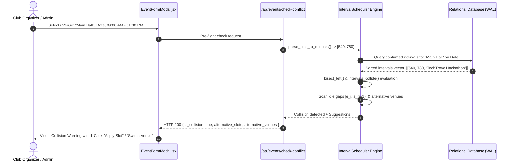

# EventFlow: Smart Campus Event Registration & Management Web Portal
### Preventing Double-Booking in Campus Venue Scheduling Using the Interval Scheduling Algorithm

[](file:///C:/Users/mithu/OneDrive/Desktop/Internet%20Programmimg/Capstone/Smart_Campus_Event_Portal_Review1.pptx)
[](https://www.python.org/)
[](https://fastapi.tiangolo.com/)
[](https://react.dev/)
[](https://vitejs.dev/)
[](https://tailwindcss.com/)
[](https://supabase.com/)
[](file:///C:/Users/mithu/OneDrive/Desktop/Internet%20Programmimg/Capstone/archive_eventflow/server/tests)

---

## 📌 Academic Metadata & Project Governance

* **Course Code & Title**: **CSA4317 – INTERNET PROGRAMMING** *(Capstone Assessment)*
* **Department & Institution**: Department of Computer Science & Engineering, **SIMATS Engineering**
* **Project Team Members**:
  * **Swathika P** (Reg. No: `192324197`)
  * **Nancy Flora** (Reg. No: `192324117`)
  * **Mithun Senthil** (Reg. No: `192324056`)
* **Faculty Guide**: **Dr. A. Selvakumar**, SIMATS Engineering
* **Base Presentation Alignment**: [`Capstone/Smart_Campus_Event_Portal_Review1.pptx`](file:///C:/Users/mithu/OneDrive/Desktop/Internet%20Programmimg/Capstone/Smart_Campus_Event_Portal_Review1.pptx) & [`MODULE_SLIDES_DATA.md`](file:///C:/Users/mithu/OneDrive/Desktop/Internet%20Programmimg/Capstone/archive_eventflow/MODULE_SLIDES_DATA.md)

---

## 📖 Executive Abstract

Modern university ecosystems host hundreds of technical hackathons, symposiums, research workshops, cultural galas, and athletic championships every semester. Historically, event coordination has relied on disconnected Google Forms, spreadsheets, physical notice boards, and transient messaging groups. This fragmentation introduces systemic operational failures: unverified attendance records, catastrophic venue double-booking conflicts, lack of capacity enforcement, and communication blackouts during emergency schedule shifts.

**EventFlow** is an enterprise-grade, centralized digital campus event registration, scheduling, and management web platform. Engineered as a high-performance ASGI application, EventFlow bridges student attendees, club organizers, estate administrators, and faculty deans into a synchronized digital workspace. 

Beyond standard event discovery, EventFlow introduces a mathematically rigorous **Interval Scheduling and Venue Double-Booking Prevention Engine**, enforcing continuous half-open interval algebra $[s_i, e_i)$ with $O(\log N)$ binary search collision detection, greedy Earliest Finish Time (EFT) batch scheduling, and automated idle gap recommendations. The system is fortified with deterministic QR credential generation (`EVF-2026-XXXX`), optical check-in scanning, native RFC 6455 WebSockets for live seat synchronization, an SMTP confirmation email daemon, and a resilient dual-mode persistence architecture (Supabase Cloud PostgreSQL + local SQLite WAL failover).

---

## 🏛️ System Architecture Overview

```mermaid
flowchart TD
    subgraph Client["Client Tier (React 18.3 + Vite 6.1 SPA)"]
        UI_Nav["Responsive Top Navbar & Mobile Drawer"]
        UI_Catalog["Searchable Event Catalog (ParticipantPortal)"]
        UI_Auth["Dedicated Login & Signup Pages"]
        UI_Passes["My Passes Digital QR Wallet"]
        UI_Admin["Organizer SaaS Command Center (AdminLayout)"]
        UI_Scanner["Optical & Simulated QR Camera Scanner"]
        UI_Form["Event Creator with Live Conflict Inspector"]
    end

    subgraph Gateway["API & Communication Gateway (FastAPI ASGI @ Port 5000)"]
        Router_Auth["/api/auth (PBKDF2 + JWT Bearer RBAC)"]
        Router_Events["/api/events (CRUD & Conflict Pre-flight)"]
        Router_Reg["/api/registrations (Atomic Capacity Control)"]
        Router_Att["/api/attendance (Idempotent QR Check-in)"]
        Router_Annc["/api/announcements (Priority Tickers)"]
        WS_Hub["Native WebSockets /ws/events & /ws/notifications"]
    end

    subgraph Engine["Algorithmic & Background Services"]
        Algo_Interval["Interval Scheduling & Bisect Collision Engine"]
        Algo_EFT["Greedy Earliest Finish Time (EFT) Batch Optimizer"]
        Service_QR["Python 2D QR Matrix Generator (Pillow)"]
        Service_SMTP["Asynchronous SMTP Mailer (HTML + Embedded QR)"]
        Daemon_Sched["APScheduler (Lifecycle Sync & 24h Reminders)"]
    end

    subgraph DataLayer["Dual-Mode Data Layer"]
        DB_Cloud[("Supabase Cloud PostgreSQL + RLS")]
        DB_Local[("SQLite WAL Mode (Local Zero-Config Failover)")]
    end

    Client <-->|"REST API (JSON) & WS Protocol"| Gateway
    Gateway --> Engine
    Engine --> DataLayer
```



---

## 🌟 Core Modules (Review 1 Specification Alignment)

EventFlow is strictly mapped to the three core operational modules defined in **Review 1 (Slide 7 & 8)**:

### 1. Module 1: User Authentication & Event Management
* **Role-Based Access Control (RBAC)**: Enforces discrete authorization boundaries across four institutional tiers: `student`, `organizer`, `faculty_dean`, and `admin`.
* **Cryptographic Security**: Salted **PBKDF2-HMAC-SHA256** password hashing (100,000 iterations) and stateless **HMAC-SHA256 JWT** Bearer tokens with constant-time string comparison (`hmac.compare_digest`).
* **Dedicated Navigation & Auth Views**: First-class, bookmarkable [LoginPage](file:///C:/Users/mithu/OneDrive/Desktop/Internet%20Programmimg/Capstone/archive_eventflow/client/src/pages/LoginPage.jsx) and [SignupPage](file:///C:/Users/mithu/OneDrive/Desktop/Internet%20Programmimg/Capstone/archive_eventflow/client/src/pages/SignupPage.jsx) with password reveal toggles, department selectors, and 1-click Demo Persona shortcuts.
* **Hierarchical Multi-Round Event Creation**: Model complex hackathons and symposiums featuring multi-track session schedules (`event_sessions`: prelims, mentoring rounds, finals) linked to distinct campus halls.

### 2. Module 2: Online Registration & QR-Based Participant Verification
* **Dynamic Catalog & Filtering**: Search events in real-time by keyword, category (`Hackathon`, `Technical`, `Cultural`, `Sports`, `Workshop`, `Seminar`), and lifecycle status (`upcoming`, `ongoing`, `completed`).
* **Atomic Capacity Control**: Strict ACID locking prevents over-registration beyond auditorium capacity during flash registration spikes.
* **Deterministic Cryptographic Passes**: Generates verifiable unique codes (`EVF-2026-XXXX`) rendered via server-side Python 2D QR matrix generation into base64 Data URLs and PNG byte streams.
* **Optical Entrance Scanner**: Interactive [TicketScannerModal](file:///C:/Users/mithu/OneDrive/Desktop/Internet%20Programmimg/Capstone/archive_eventflow/client/src/components/admin/TicketScannerModal.jsx) integrating camera scanning and manual pass verification, enforcing idempotent check-ins with tamper-evident replay prevention.

### 3. Module 3: Real-Time Notifications & Automated Lifecycle Daemon
* **RFC 6455 WebSockets Hub**: Native FastAPI WebSockets (`/ws/events`, `/ws/notifications`) broadcast seat count decrements, check-in tallies, and urgent campus bulletin notices instantaneously across all active browser sessions without HTTP polling overhead.
* **Asynchronous SMTP Email Dispatcher**: Transmits branded HTML confirmation emails with embedded QR tickets, venue room coordinates, and schedule milestones. Operates with an offline console-logging fallback to guarantee transaction durability even when external SMTP relays are unreachable.
* **APScheduler Background Engine**: Automated background daemon managing periodic status transitions (`upcoming` ➔ `ongoing` ➔ `completed`) and queuing automated 24-hour delegate reminders.

---

## ⚡ The Unique Feature: Mathematical Interval Scheduling & Collision Prevention

> [!IMPORTANT]
> **Academic Innovation & Computer Science Depth**  
> While 95% of typical college event portals are simple CRUD database forms, EventFlow introduces an **Algorithmic Interval Scheduling Engine** that eliminates the campus venue double-booking dilemma.



### 1. Discrete Half-Open Interval Algebra $[s, e)$
Every reservation request is mapped from human time strings (`"09:00 AM"`, `"01:00 PM"`) into discrete minutes from midnight $t \in [0, 1440)$.
Two intervals $I_1 = [s_1, e_1)$ and $I_2 = [s_2, e_2)$ collide if and only if:
$$\text{Collision}(I_1, I_2) \iff (s_1 < e_2) \land (s_2 < e_1)$$

* **Contiguous Boundary Integrity**: Under half-open algebra, an event ending exactly at 11:00 AM ($e_1 = 660$) and an adjacent event starting at 11:00 AM ($s_2 = 660$) are valid neighbors ($660 < 660$ is False), **eliminating false-positive boundary rejections**.
* **Enclosed & Partial Intersection**: Detects nested intervals (e.g. 09:00 AM–05:00 PM enclosing 10:00 AM–12:00 PM) and partial overlaps (10:00 AM–01:00 PM overlapping 12:00 PM–03:00 PM).

### 2. $O(\log N)$ Binary Search Temporal Placement
Instead of running expensive linear $O(N)$ full-table scans, confirmed reservations for venue resource $V_k$ are stored in a sorted timeline vector. The engine uses `bisect_left` to pinpoint the temporal insertion index in $O(\log N)$ time, validating only immediate predecessor and successor candidates.

### 3. Intelligent Gap Discovery & Venue Recommendations
Upon collision detection, the engine calculates:
* **Nearest Idle Slot**: Scans the campus operating window (08:00 AM to 08:00 PM) for the nearest vacant gap $[e_i, s_{i+1})$ where $(s_{i+1} - e_i) \ge \Delta t_{req}$.
* **Alternative Campus Venues**: Cross-references the entire campus venue inventory (Auditoriums, Sports Arenas, Seminar Halls) and suggests halls that are 100% vacant for the exact requested timeframe.

### 4. Greedy Earliest Finish Time (EFT) Batch Optimization
When multiple student clubs submit conflicting reservation batches for the same hall, the engine executes the greedy **Earliest Finish Time (EFT)** algorithm:
1. Sorts all competing requests by finish time $e_1 \le e_2 \le \dots \le e_M$.
2. Greedily admits the first event finishing earliest.
3. Iteratively admits each subsequent event whose start time $s_i \ge \text{last\_finish}$.
4. **Guarantees maximum compatible event throughput** in $O(M \log M)$ time.

---

## 🗄️ Relational Database Entity Model

The relational data model enforces strict referential integrity across 6 normalized entities:

```
+------------------+         +------------------+         +------------------+
|    organizers    | 1     N |      events      | 1     N |  event_sessions  |
|------------------|---------|------------------|---------|------------------|
| id (PK)          |         | id (PK)          |         | id (PK)          |
| user_id (FK)     |         | organizer_id(FK) |         | event_id (FK)    |
| name             |         | title            |         | round_name       |
| email            |         | category         |         | venue_room       |
| department       |         | venue            |         | start_time       |
| role             |         | date             |         | end_time         |
+------------------+         | start_time       |         | order_index      |
                             | end_time         |         +------------------+
                             | capacity         |
                             | registered_count |
                             +--------+---------+
                                      | 1
                                      |
                                      | N
+------------------+         +--------+---------+         +------------------+
|      users       | 1     N |  registrations   | 1     1 |    attendance    |
|------------------|---------|------------------|---------|------------------|
| id (PK)          |         | id (PK)          |         | id (PK)          |
| name             |         | event_id (FK)    |         | registration_id  |
| email (UQ)       |         | ticket_code (UQ) |         | event_id (FK)    |
| password_hash    |         | participant_name |         | status           |
| role             |         | email            |         | check_in_time    |
| department       |         | department       |         +------------------+
+------------------+         +------------------+
```

---

## 🛠️ Technology Stack Breakdown

| Layer | Technologies Selected | Strategic Rationale |
|---|---|---|
| **Frontend Framework** | **React 18.3 + Vite 6.1** | Component-driven reactivity, ultra-fast HMR, sub-second production bundling. |
| **Styling & Design** | **Tailwind CSS 3.4** | Cohesive 6-tier **Poppins typography hierarchy** (300 to 900), glassmorphic backdrops, mobile-first responsiveness. |
| **Backend Framework** | **FastAPI 0.110+ (Python 3.11)** | Asynchronous ASGI execution, native WebSockets, Pydantic v2 data validation, automated OpenAPI 3.1 Swagger docs. |
| **Security & Auth** | **PyJWT + PBKDF2 / Bcrypt** | Salted password hashing, stateless JWT authorization tokens, RBAC dependency injection. |
| **QR Engine** | **Pillow 10.0 + html5-qrcode** | High-performance server-side 2D QR matrix rendering; browser camera scanner with optical barcode recognition. |
| **Real-Time Layer** | **Native WebSockets (RFC 6455)** | Full-duplex persistent connection for instantaneous ticket counts and urgent broadcasts. |
| **Scheduler & Mailer** | **APScheduler 3.10 + SMTP** | Asynchronous cron daemon for event status lifecycles and HTML email dispatches. |
| **Data Persistence** | **SQLite WAL + Supabase Cloud** | Zero-configuration local ACID persistence with transparent cloud failover to managed PostgreSQL. |

---

## 🧪 Verification & Automated Test Suite

EventFlow includes an automated Pytest test suite with **51 tests** passing in **1.53s**, guaranteeing zero regression across all core subsystems:

```powershell
cd "Capstone\archive_eventflow\server"
pytest tests -v
```

### Test Coverage Matrix
* ✅ **Interval Scheduling Engine (`test_interval_scheduler.py` - 5 Tests)**:
  * Discrete minute conversions and string formatting.
  * Half-open collision algebra verification ($[09:00, 11:00)$ and $[11:00, 13:00)$ boundary neighbors allowed).
  * Pre-flight `/api/events/check-conflict` validation.
  * Real-world venue double-booking flow (conflicting booking rejected with HTTP 409).
  * Greedy Earliest Finish Time (EFT) batch optimization ($O(M \log M)$ throughput).
* ✅ **Authentication & Security (`test_auth.py` - 6 Tests)**:
  * Salted password hashing and constant-time verification.
  * JWT token encoding, decoding, and expiration enforcement.
  * Role validation for Student, Organizer, Faculty Dean, and Admin accounts.
  * Route protection on `/api/auth/me`.
* ✅ **Event Operations (`test_events.py` - 5 Tests)**:
  * Event creation, multi-round session cascading, search queries, category filters, and deletion.
* ✅ **Capacity & Ticketing (`test_registrations.py` - 6 Tests)**:
  * Atomic capacity capping (400 Bad Request on overflow), duplicate ticket prevention (409 Conflict), UTF-8 CSV roster export.
* ✅ **Attendance & Check-in (`test_attendance.py`, `test_qr_attendance.py` - 8 Tests)**:
  * Unique pass validation (`EVF-2026-XXXX`), idempotent check-in timestamps, optical scan replay rejection.
* ✅ **Real-Time & Background Daemons (`test_websockets.py`, `test_scheduler.py`, `test_email_service.py` - 8 Tests)**:
  * WebSocket connection lifecycle, message broadcast, APScheduler jobs, offline email resilience.
* ✅ **Database & Health (`test_database.py`, `test_health.py` - 7 Tests)**:
  * WAL journal mode, foreign key cascades, transaction rollbacks.
* ✅ **Frontend Production Bundle**:
  * 1,659 modules transformed with **0 compilation errors** via Vite (`npm run build`).

---

## 🚀 Quickstart & Execution Guide

### Option 1: 1-Click Launch (Recommended for Windows)

In Windows Explorer or a terminal, navigate to [`Capstone/archive_eventflow`](file:///C:/Users/mithu/OneDrive/Desktop/Internet%20Programmimg/Capstone/archive_eventflow) and run:

```cmd
cd "Capstone\archive_eventflow"
start_dev.bat
```
*(Automatically launches two dedicated console windows: FastAPI Backend on port 5000 and React Frontend on port 5173).*

### Option 2: Manual Startup

#### Terminal 1 — Start FastAPI Server:
```powershell
cd "Capstone\archive_eventflow"
python server/run.py
```
* **API Endpoint**: `http://localhost:5000`
* **Swagger Documentation**: `http://localhost:5000/docs`

#### Terminal 2 — Start React Web App:
```powershell
cd "Capstone\archive_eventflow\client"
npm run dev
```
* **Web Portal Client**: `http://localhost:5173`

---

## 🔑 Pre-Seeded Demonstration Personas

All pre-seeded test accounts use the default password: **`password123`**

| Role | Email Address | Password | Capabilities & Access Scope |
|---|---|---|---|
| **Student Attendee** | `aditya.nair@college.edu` | `password123` | Event browsing, 1-click registration, digital QR ticket passbook. |
| **Student Attendee** | `sneha.patel@college.edu` | `password123` | Multi-event registration and attendance pass lookup. |
| **Club Organizer** | `aarav.sharma@college.edu` | `password123` | Event creation with interval collision inspection, multi-round session timelines, optical QR check-in scanner. |
| **Faculty Dean** | `k.raman@college.edu` | `password123` | Campus-wide announcement broadcasts, attendance reports, UTF-8 CSV exports. |
| **System Admin** | `meenakshi@college.edu` | `password123` | Administrative oversight, real-time KPI analytics, system parameter management. |

---

## 👥 Contributors & Academic Acknowledgments

* **Swathika P** (Reg. No: `192324197`) — Frontend Architecture, QR Ticket Scanner & UI/UX Design System
* **Nancy Flora** (Reg. No: `192324117`) — Relational Database Schema, Supabase Dual-Mode Integration & Documentation
* **Mithun Senthil** (Reg. No: `192324056`) — Mathematical Interval Scheduling Engine, FastAPI Backend & WebSockets Hub
* **Faculty Guide**: **Dr. A. Selvakumar**, SIMATS Engineering
